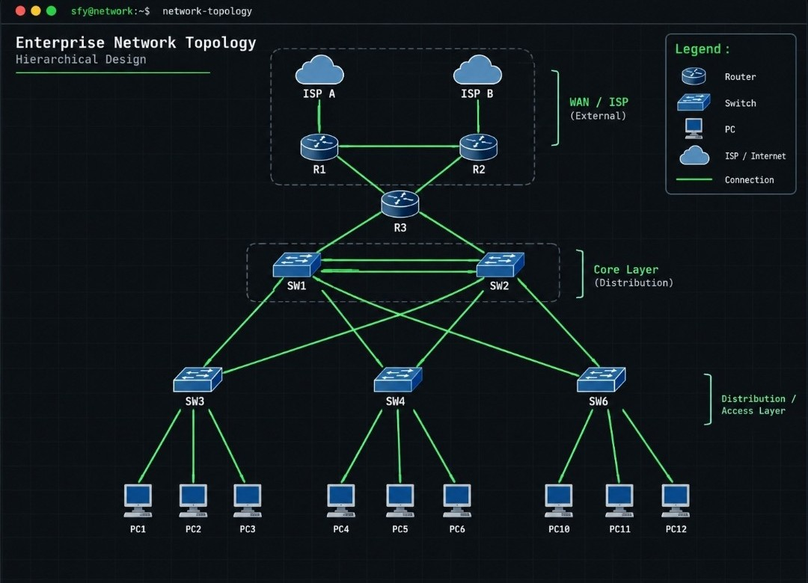
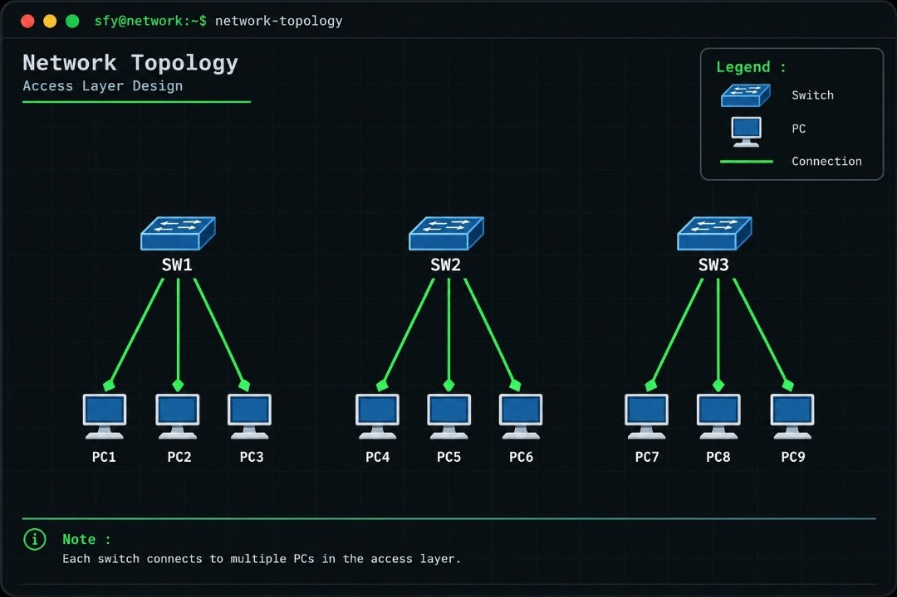
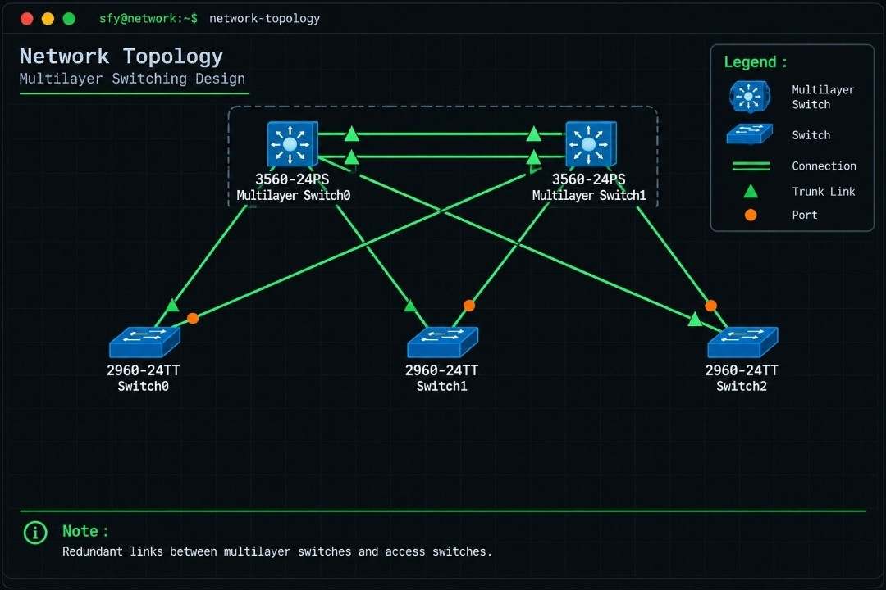
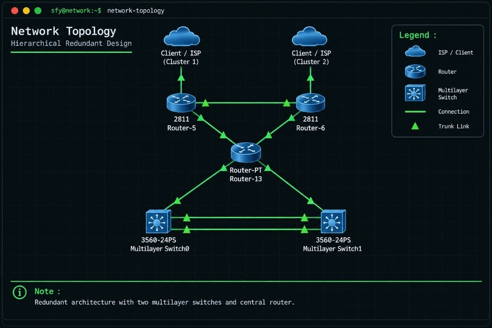

# enterprise-network-topology
Hierarchical Enterprise Network Architecture featuring VLAN, 802.1Q Trunking, LACP EtherChannel, RSTP, HSRP, DHCP Split-Scope, OSPF Area 0, Dual-ISP Failover, NAT PAT, and Extended ACL.
# Enterprise Network Topology: Hierarchical & Redundant Design



## 📋 Ringkasan Proyek (Project Overview)
Proyek ini merupakan simulasi desain dan implementasi jaringan *Enterprise* berstandar industri yang mengutamakan **High Availability**, **Redundancy**, dan **Security**. Arsitektur dibangun secara bertahap menggunakan metode **Bottom-Up** dari Layer 2 hingga Layer 3.

### 🗺️ Pemetaan Perangkat (Device Mapping)
* **WAN / Edge Routers:** `R1` (ISP A Utama) & `R2` (ISP B Cadangan)
* **Core Router:** `R3` (Central Core Router)
* **Distribution Layer (Multilayer Switch 3560):** `SW1` (MLS Primary) & `SW2` (MLS Secondary)
* **Access Layer (Switch 2960):** `SW3`, `SW4`, `SW5` (Terhubung ke `PC1`–`PC9`)

---

## 🏗️ Arsitektur & Pembagian Modul Jaringan

### Bagian 1: Access Layer Design (End-User & Segmentasi VLAN)


Lapisan akses (`SW3`, `SW4`, `SW5`) menghubungkan perangkat pengguna akhir (`PC1`–`PC9`) dan memisahkan lalu lintas ke dalam tiga segmen (`VLAN 10` Management, `VLAN 20` Server, dan `VLAN 30` Staff) menggunakan jalur *802.1Q Trunking*.

```cisco
! Konfigurasi VLAN & Trunking pada Access Switch (SW3, SW4, SW5)
SW3(config)# vlan 10,20,30
SW3(config-vlan)# exit
SW3(config)# interface range GigabitEthernet0/1 - 2
SW3(config-if-range)# switchport mode trunk
SW3(config-if-range)# switchport trunk allowed vlan 10,20,30
```

---

### Bagian 2: Distribution & Multilayer Switching Design


Lapisan distribusi menggunakan sepasang **Cisco Catalyst 3560 Multilayer Switch (`SW1` & `SW2`)** yang menangani agregasi Layer 2 dan *routing* internal Layer 3:
* **LACP EtherChannel (`Port-channel 1`):** Menggabungkan dua jalur fisik antar-MLS untuk kapasitas *bandwidth* ganda.
* **RSTP (`Rapid PVST+`):** Mencegah *Layer 2 Loop* dengan `SW1` sebagai *Root Primary* dan `SW2` sebagai *Root Secondary*.
* **SVI, HSRP & DHCP Split-Scope:** Menyediakan *Inter-VLAN Routing*, *Virtual Gateway* (`192.168.1.254`), dan pembagian IP otomatis 50/50 tanpa konflik.

```cisco
! Konfigurasi Utama pada SW1 (MLS Primary)
SW1(config)# interface range GigabitEthernet0/1 - 2
SW1(config-if-range)# channel-protocol lacp
SW1(config-if-range)# channel-group 1 mode active
SW1(config-if-range)# exit
SW1(config)# interface port-channel 1
SW1(config-if)# switchport trunk encapsulation dot1q
SW1(config-if)# switchport mode trunk
SW1(config-if)# switchport trunk allowed vlan 10,20,30

SW1(config)# spanning-tree mode rapid-pvst
SW1(config)# spanning-tree vlan 1,10,20,30 root primary

SW1(config)# ip routing
SW1(config)# interface vlan 10
SW1(config-if)# ip address 192.168.1.252 255.255.255.0
SW1(config-if)# standby 10 ip 192.168.1.254
SW1(config-if)# standby 10 priority 110
SW1(config-if)# standby 10 preempt
SW1(config-if)# no shutdown

SW1(config)# ip dhcp excluded-address 192.168.1.125 192.168.1.254
SW1(config)# ip dhcp pool VLAN10
SW1(dhcp-config)# network 192.168.1.0 255.255.255.0
SW1(dhcp-config)# default-router 192.168.1.254
SW1(dhcp-config)# dns-server 8.8.8.8
```

---

### Bagian 3: Core Routing, WAN Failover & Network Security


Lapisan *Core* dan *Edge* menghubungkan jaringan internal ke **ISP A (`R1`)** dan **ISP B (`R2`)** melalui Core Router **`R3`**:
* **OSPF Area 0:** Pertukaran tabel rute dinamis di atas subnet `/30`.
* **Dual-ISP Failover:** `R1` menjadi jalur utama (AD `1`) dan `R2` menjadi jalur cadangan (*Floating Static Route* AD `200`).
* **NAT Overload (PAT) & Extended ACL:** Translasi IP lokal ke publik serta pemblokiran akses divisi Staff (`VLAN 30`) menuju server internal.

```cisco
! OSPF Area 0 pada Core Router R3
R3(config)# router ospf 1
R3(config-router)# network 10.1.1.0 0.0.0.3 area 0
R3(config-router)# network 10.1.1.4 0.0.0.3 area 0

! Dual-ISP Failover pada R2 (ISP Cadangan AD 200)
R2(config)# ip route 0.0.0.0 0.0.0.0 192.168.60.2 200
R2(config)# router ospf 1
R2(config-router)# default-information originate

! NAT Overload / PAT (R1 & R2)
R1(config)# access-list 1 permit 192.168.1.0 0.0.0.255
R1(config)# access-list 1 permit 192.168.2.0 0.0.0.255
R1(config)# access-list 1 permit 192.168.3.0 0.0.0.255
R1(config)# ip nat inside source list 1 interface GigabitEthernet0/2 overload

! Extended ACL IPv4 pada SW1 & SW2
SW1(config)# ip access-list extended BLOKIR_STAFF
SW1(config-ext-nacl)# deny ip 192.168.3.0 0.0.0.255 192.168.1.0 0.0.0.255
SW1(config-ext-nacl)# deny ip 192.168.3.0 0.0.0.255 192.168.2.0 0.0.0.255
SW1(config-ext-nacl)# permit ip any any
SW1(config-ext-nacl)# exit
SW1(config)# interface vlan 30
SW1(config-if)# ip access-group BLOKIR_STAFF in
```

---

## 🛠️ Verifikasi & Pengujian (Troubleshooting)

| Teknologi | Perintah Verifikasi | Indikator Status Normal |
| :--- | :--- | :--- |
| **LACP EtherChannel** | `show etherchannel summary` | Kode `Po1(SU)` dengan port anggota `(P)`. |
| **802.1Q Trunking** | `show interfaces trunk` | Interface `Po1` berstatus *trunking* (`VLAN 10,20,30`). |
| **RSTP** | `show spanning-tree` | Mode `rstp` dan `SW1` sebagai *Root Bridge*. |
| **HSRP** | `show standby brief` | `SW1` berstatus `Active`, `SW2` `Standby`, VIP `.254`. |
| **DHCP Split-Scope** | `show ip dhcp binding` | Alamat IP klien terbagi rata tanpa konflik. |
| **OSPF & Failover** | `show ip ospf neighbor` & `show ip route` | Tetangga `FULL` dan muncul rute default `O*E2 0.0.0.0/0`. |
| **NAT & Extended ACL** | `show ip nat translations` & `show access-lists` | Translasi IP aktif dan counter *matches* ACL berjalan. |

### 📑 Dokumen Panduan Teknis (PDF)
👉 **[Klik di Sini untuk Membaca / Mengunduh Dokumen Teknis Lengkap (6 Halaman PDF)](Rangkuman_Arsitektur_Jaringan_Enterprise.pdf)**

